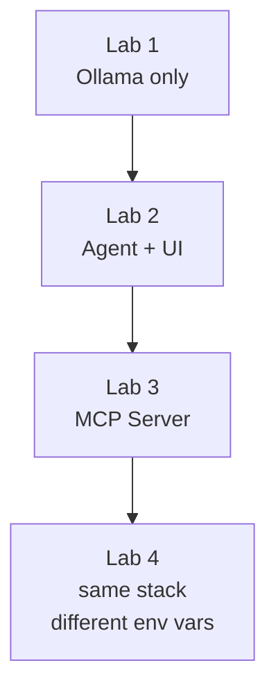

## Your session steps

Setup takes roughly 20–30 minutes: about 5 minutes to deploy the AKS cluster, plus installing the Lab 1 Helm chart.

1. {} REQUIRED {} [Kubernetes & Helm Setup](1_k8s_helm_setup/): deploy a Managed Kubernetes Service (AKS) on Azure (about 5 minutes), then install the Lab 1 chart with Helm and confirm it works.

    - kubectl, Helm and jq utilities are already installed on the bastion.

2. {} Optional {} [Kubernetes Fundamentals](2_k8s_fundamentals/): for your information only. Skip it if you already know Pods, Deployments and Namespaces.

3. {} REQUIRED {} Deploy lab applications to the AKS cluster with Helm as each lab describes.

## Lab Stack overview

The lab application is four containers deployed to Kubernetes with Helm: **Ollama** (runs the AI model), the **agent** (an LLM plus the code that lets it use tools), an **MCP server** (a standard way to offer tools to an agent), and a chat **UI**. Each lab adds one layer:

{}
While we'll utilize Kubernetes (K8S) in this class, along with kubectl to manage K8S clusters, and Helm to install apps on the clusters, THIS IS NOT A K8S workshop.  That's here: https://fortinetcloudcse.github.io/k8s-101-workshop/.  Arguably, you may not need to fully understand K8S to understand what's going on in this workshop. :sunglasses:

{}

{}
The single configuration value that controls which LLM the agent talks to is
`OPENAI_BASE_URL`. By default it points at the local Ollama container. If you
want to route through FortiAIGate instead, that is the only value you change —
the agent image, MCP server, and UI are identical.
{}
