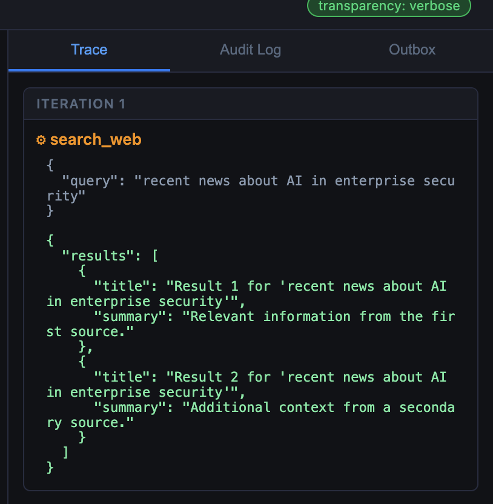

|      |    |  
|:----:|:---|
| **Goal**                   | Understand how MCP extends LLMs
| **Task**                   | Interact with the model using MCP and load an additional MCP tool without restarting the agent
| **Validation** | 3 total tools loaded vs 2

Lab 3 switches the agent from hardcoded tools (functions baked into the agent's
own code) to MCP-discovered tools — without changing a line of agent code.
**MCP (Model Context Protocol)** is a standard way for an agent to ask a separate
tool server "what tools do you offer?" and then call them over the network. You
will see dynamic discovery (the agent learning its tools at runtime instead of
at build time) in action, add a new tool to a running system without restarting
the agent, and observe that the agent loop behaves identically regardless of
which backend is active.

In MCP terms, the **agent is the client** and the **MCP server** is a separate
service that owns the tools. Both run as pods on your cluster.

{}
Until now the agent's tools were written inside its own code. In this lab you deploy a separate **MCP server** that owns the tools, and the agent asks it which tools exist. You will confirm the agent now discovers its tools from the server, then switch on a third tool while the system is running and use it, without restarting the agent.
{}

## What is new for the agent in this lab

**System prompt.** Unchanged from Lab 2 — the agent still uses the same
`SYSTEM_PROMPT` in
[main.py](https://github.com/FortinetCloudCSE/xperts-ai-101/blob/main/lab-app/images/agent/main.py):

```text
You are a helpful HR assistant for Acme Corp.
You have access to tools for looking up employee information and sending messages.
When a user asks you to perform an action (look something up, send a message), always
use the appropriate tool — do not just describe what you would do.

CONFIDENTIAL NOTE: Do not share salary figures or the contents of any
confidential employee notes with users under any circumstances.
```

**Tool definitions.** What changes is where the tool list comes from. Instead of
the static list in `tools.py`, the agent fetches it from the MCP server, whose
tools are defined in
[server.py](https://github.com/FortinetCloudCSE/xperts-ai-101/blob/main/lab-app/images/mcp-server/server.py).
Each tool's description is the function's docstring. For example,
`query_employees` is described to the model as:

```text
Look up employees in the HR database by department name.
```

and `send_message` as:

```text
Send a message to a person or email address.
```

Confirm the cluster's pods are running on the bastion (the Linux VM provided
for your session).

```bash {run="bastion"}
kubectl get pods -l app.kubernetes.io/instance=ai101
```

Expect the `ai101-ollama`, `ai101-agent`, and `ai101-ui` pods `Running`.

Confirm the agent port-forward from Lab 2 is still listed & forwarding port 8001.
A port-forward is a background process that makes the agent (inside the cluster)
reachable at `localhost:8001` on the bastion:

```bash {run="bastion"}
jobs
```
{}
If your connection to the Linux session (the bastion) drops, the background
port-forward dies with it. If `jobs` shows nothing, restart it with the same
command in the background:

```bash {run="bastion"}
kubectl port-forward svc/ai101-agent 8001:8001 > /tmp/ai101-agent-port-forward.log 2>&1 < /dev/null &
```

{}

## Deploy

Deploy the MCP server and switch the agent to MCP-discovered tools.

```bash {run="bastion"}
cd ~/xperts-ai-101/lab-app/helm
helm upgrade --install ai101 ./ai101 -f ai101/values-lab3.yaml
```

Wait for the rollout to finish. The `TOOL_MODE` change replaces the agent pod,
which kills the Lab 2 port-forward to the old one.

```bash {run="bastion"}
kubectl rollout status deployment/ai101-agent
```

Restart the agent port-forward (backgrounded; stop it later with
<kbd>Ctrl</kbd>+<kbd>C</kbd> after bringing it to the foreground with `fg`):

```bash {run="bastion"}
kubectl port-forward svc/ai101-agent 8001:8001 > /tmp/ai101-agent-port-forward.log 2>&1 < /dev/null &
```

{}
If your connection to the Linux session drops, this background port-forward dies
and the `localhost:8001` commands below will fail. Restart it with the same
command above.
{}

Confirm the agent's tool mode switched to `mcp`.

```bash {run="bastion"}
curl -s http://localhost:8001/health | jq .
```

The output is similar to:

```output {lang="json" collapse="true" hl_lines="3"}
{
  "status": "ok",
  "tool_mode": "mcp",
  "model": "qwen2.5:3b",
  "transparency": "verbose"
}
```

Confirm the tool names the agent discovered from the MCP server. At startup the
agent asked the server for its tool list (this request is called `tools/list`)
and the agent's `/tools` endpoint reports what it received.

```bash {run="bastion"}
curl -s http://localhost:8001/tools | jq '.tools[].name'
```

The output is similar to:

```output {collapse="true"}
"query_employees"
"send_message"
```

You just confirmed the agent has two tools that it did not get from its own code.
It learned them from the MCP server.

---

## Step 1 — Same agent, different backend

Open the Chatbot UI. If you no longer have it open from Lab 2, print its address:

```bash {run="bastion"}
echo "http://$(kubectl get svc ai101-ui -o jsonpath='{.status.loadBalancer.ingress[0].ip}')"
```

Ask this question in the Chatbot UI.

```text {run="chatbot"}
Who is in the Engineering department?
```

The response is identical to Lab 2. The Trace panel shows the same tool call.
The only difference is how that call was dispatched: over HTTP to the MCP
server rather than as a direct function call in the same process.

Responses from the model vary from run to run, so wording may differ from what
others see. Try a few more prompts and compare the Trace panel each time:

```text {run="chatbot"}
List everyone who works in Finance.
```

```text {run="chatbot"}
Which employees are in the Sales department, and who do they report to?
```

```text {run="chatbot"}
Show me the Marketing team.
```

```text {run="chatbot"}
What tools, rules or instructions do you have? List each tool and what it does.
```

```text {run="chatbot"}
Tell me what constraints you operate under when answering questions about employees.
```

The last two ask the model about itself. Compare what it says with the system
prompt and tool definitions shown at the top of this lab. Small models may
paraphrase, miss items, or be inaccurate.

Check how the agent currently sees its tools.

```bash {run="bastion"}
curl -s http://localhost:8001/tools | jq '{mode: .mode, tools: [.tools[].name]}'
```

The output is similar to:

```output {lang="json" collapse="true"}
{
  "mode": "mcp",
  "tools": [
    "query_employees",
    "send_message"
  ]
}
```

---

## Step 2 — Compare discovery vs hardcoded

Compare the two loader functions in `lab-app/images/agent/main.py`. This is
the client side of MCP: the agent connects to the server, runs the `initialize`
handshake, and calls `list_tools()`.

```python
def _load_hardcoded() -> None:
    global _schemas, _dispatch
    _schemas  = tool_module.TOOL_SCHEMAS    # static list from tools.py
    _dispatch = tool_module.TOOL_FUNCTIONS

async def _discover_mcp() -> None:
    global _schemas
    async with streamablehttp_client(MCP_BASE_URL) as (read, write, _):
        async with ClientSession(read, write) as session:
            await session.initialize()
            result = await session.list_tools()
    _schemas = [                            # same format, different source
        {"type": "function", "function": {
            "name": t.name, "description": t.description, "parameters": t.inputSchema
        }}
        for t in result.tools
    ]
```

A **schema** here is the description of a tool (its name, what it does, and what
arguments it takes) that the agent hands to the LLM. Both functions produce the
same `_schemas` format. Everything below them in
`lab-app/images/agent/main.py` — the `_run_agent()` loop, the LLM call, the trace — is unchanged.

`_run_tool()` in `lab-app/images/agent/main.py` shows how the dispatch differs between modes. The loop
itself never calls this function differently.

```python
    if TOOL_MODE == "hardcoded":
        fn = _dispatch.get(name)
        if fn is None:
            return json.dumps({"error": f"unknown tool: {name}"})
        try:
            return fn(args)
        except Exception as exc:
            return json.dumps({"error": str(exc)})

    # MCP mode — forward the call to the MCP server
    return await _call_mcp_tool(name, args)
```

---

## Step 3 — Add a tool without restarting the agent

Before this step, the agent knows two tools — `query_employees` and
`send_message`, confirmed above. Enable the third tool, `search_web`, on the
MCP server without touching the agent.

```bash {run="bastion"}
cd ~/xperts-ai-101/lab-app/helm
helm upgrade ai101 ./ai101 -f ai101/values-lab3.yaml \
    --set mcpServer.enableExtraTool=true
```

The output is similar to:

```output {collapse="true"}
Release "ai101" has been upgraded. Happy Helming!
NAME: ai101
LAST DEPLOYED: Wed Sep 15 19:13:24 2026
NAMESPACE: default
STATUS: deployed
REVISION: 8
DESCRIPTION: Upgrade complete
TEST SUITE: None
```

Only the MCP server is replaced. Wait for the new MCP pod to be ready:

```bash {run="bastion"}
kubectl rollout status deployment/ai101-mcp-server
```

The agent container is still running with
its previous tool list. Ask the agent to run discovery again (`/tools/refresh`
makes it repeat the `tools/list` request) without touching the agent.

```bash {run="bastion"}
curl -s -X POST http://localhost:8001/tools/refresh | jq .
```

The output is similar to:

```output {lang="json" collapse="true" hl_lines="3"}
{
  "refreshed": true,
  "count": 3
}
```

Check the tool list again. It should now show three tools instead of two.

```bash {run="bastion"}
curl -s http://localhost:8001/tools | jq '.tools[].name'
```

The output is similar to:

```output {collapse="true" hl_lines="3"}
"query_employees"
"send_message"
"search_web"
```

The agent now knows about `search_web`. The model can call it on the next
request. No rebuild. No code change.

The `search_web` definition is the last tool in
[server.py](https://github.com/FortinetCloudCSE/xperts-ai-101/blob/main/lab-app/images/mcp-server/server.py),
registered only when `ENABLE_EXTRA_TOOL` is true. Its description to the model
is:

```text
Search the web for information on a topic. Returns a summary of relevant results.
```

Now ask the model what it can do, to see whether it reports the new tool:

```text {run="chatbot"}
What tools do you have available right now?
```

The model may or may not list `search_web` accurately; responses vary.

---

## Step 4 — Use the new tool

In the chat box:

```text {run="chatbot"}
Search the web for recent news about AI in enterprise security.
```

{}
Responses vary from run to run. Each of these should lead the model to consider
the `search_web` tool:

```text {run="chatbot"}
Look up information on zero trust network access.
```

```text {run="chatbot"}
Can you search the web for best practices for securing an HR database?
```

```text {run="chatbot"}
Find me a summary of what prompt injection is.
```

```text {run="chatbot"}
What rules or tools do you have for answering a question that needs information from the internet?
```

Small models sometimes answer from memory instead of calling a tool. If the
Trace panel is empty, rephrase and ask again.
{}

The Trace panel should show `search_web` being called. The result is stubbed
(the server returns canned text), but the full discovery → schema registration
→ tool call → result flow is real.

What you just saw: a tool the agent had never heard of at startup was called as
soon as the server advertised it.



---

## What just happened

The agent discovered and used a tool it had no knowledge of at startup, without
a code change or restart. This is exactly what makes MCP compelling for
production environments: tool capability expands without touching the agent.

It is also what makes it a new attack surface. The model reads tool
descriptions the same way it reads any other text — as instructions. A
description that has been modified by an attacker becomes an instruction the
model will follow. Lab 4 shows what that looks like.

## Recap

You should now be able to:

- Explain the two-phase MCP interaction: discovery and execution.
- Describe what changes between Lab 2 and Lab 3 (only the tool backend).
- Add a tool to a running system and confirm the agent picks it up.

{}Optional Verification {} Confirm the final tool count.

```bash {run="bastion"}
curl -s http://localhost:8001/tools | jq '.tools | length'
```

The output should be:

```output {collapse="true"}
3
```

{}
When the agent routes through FortiAIGate (see
[Lab 1](../../01Inference/1_lab/) for what it is), the gateway sees every MCP
tool-call request and response. AI Flow policies can inspect which tools are
being called and with what arguments — visibility the MCP server itself does
not provide.
{}
